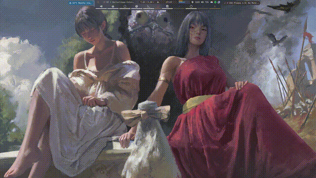

# WallEclipse

Preloaded layer-shell wallpaper daemon for Hyprland. Extension of [ArchEclipse](https://github.com/AymanLyesri/ArchEclipse).
Replaces `hyprpaper` + `wallpaper-loop.c`; `mpvpaper` stays for animated wallpapers (gif/mp4/webm).
Workspace slide transitions also cover animated wallpapers via a static
poster bridge: the first switch to/from a video slides to/from its
extracted poster frame (cached in `~/.cache/walleclipse/posters`),
then hands off to `mpvpaper`.

## Why

hyprpaper 0.8 removed `preload`, so every workspace switch re-loads from disk
(`hyprctl hyprpaper wallpaper`). WallEclipse decodes **all** workspace
wallpapers once at startup into RAM (threadpool) and switches with a local
`wl_surface.attach` — no compositor round-trip on the hot path.
